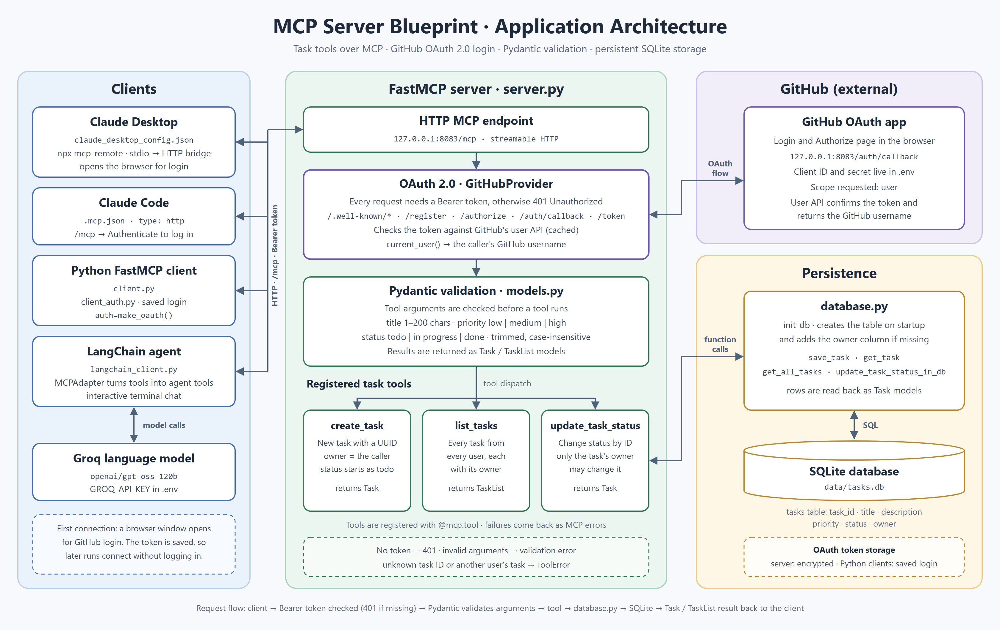
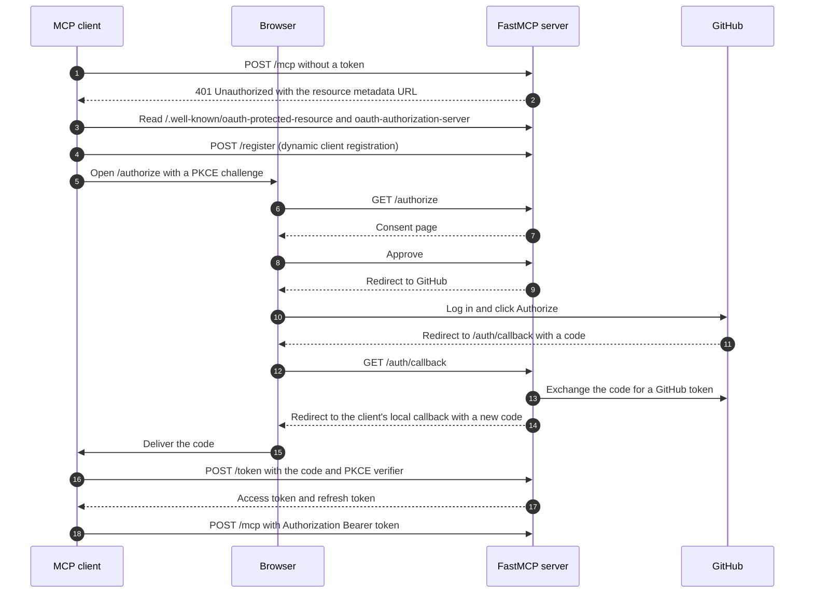
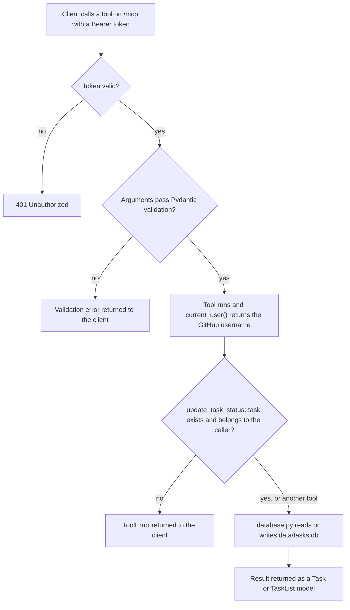

# Crewboard MCP Server

> An end-to-end learning project for building an MCP server with GitHub OAuth 2.0 login, Pydantic validation, and persistent SQLite storage, then connecting Claude, Python, and LangChain clients to it.


[](LICENSE)

This repository demonstrates a practical MCP pattern: expose ordinary Python functions as tools, protect them with OAuth 2.0, validate every call with Pydantic, and persist the data in SQLite. The example is a small task manager with tools to create, list, and update tasks. Users log in with their GitHub account; every task records who created it, everyone who is logged in can see all tasks, and only a task's owner can change its status.

The same server is used by Claude Desktop, Claude Code, a Python FastMCP client, and a LangChain agent backed by a Groq model. Use it to learn how the pieces fit together, then adapt the server and tools to your own project. This is a local learning blueprint, not a production-ready service.

## Contents

- [What you will build](#what-you-will-build)
- [Architecture](#architecture)
- [Available tools](#available-tools)
- [Quick start](#quick-start)
- [Connect a client](#connect-a-client)
- [Optional: use the LangChain agent](#optional-use-the-langchain-agent)
- [Project structure](#project-structure)
- [Data model](#data-model)
- [Where login data is stored](#where-login-data-is-stored)
- [Extend the blueprint](#extend-the-blueprint)
- [Practical notes](#practical-notes)
- [Troubleshooting](#troubleshooting)
- [Further reading](#further-reading)
- [License](#license)

## What you will build

- An HTTP MCP server built with [FastMCP](https://gofastmcp.com/), listening on `http://127.0.0.1:8083/mcp`.
- **GitHub OAuth 2.0 login.** Requests without a valid token are rejected with `401 Unauthorized`. MCP clients discover the login endpoints automatically and open a browser for the user to sign in.
- **Pydantic validation.** Tool arguments are checked before a tool runs, and results are returned as typed models with a published JSON schema.
- Three discoverable tools for managing tasks, with **per-user ownership**: all logged-in users see every task, but only the creator can change a task's status.
- A SQLite database that keeps tasks between server restarts.
- Ready-made connections for Claude Desktop, Claude Code, a Python client, and a LangChain agent.

## Architecture



A request passes through four layers, each in its own module:

| Layer | Module | Responsibility |
|---|---|---|
| Clients | `client.py`, `langchain_client.py`, Claude Desktop, Claude Code | Discover and call tools over HTTP, and run the browser login the first time they connect. |
| Authentication | `server.py` (`GitHubProvider`) | Serves the OAuth endpoints, rejects requests without a valid token, and exposes the caller's GitHub username through `current_user()`. |
| Validation and tools | `models.py`, `server.py` | Pydantic types describe and check every argument and result; the `@mcp.tool` functions apply the ownership rules. |
| Persistence | `database.py` | Reads and writes `data/tasks.db` and turns rows back into `Task` models. |

### Login flow (OAuth 2.0)

The server acts as an OAuth proxy in front of GitHub. MCP clients never see your GitHub client secret; they register with the server, the user logs in to GitHub in a browser, and the server issues its own access token.



After the first login, clients that save their tokens (Claude Desktop through `mcp-remote`, Claude Code, and the bundled Python clients) connect directly with step 18 and refresh the token when it expires.

### Tool call flow



## Available tools

| Tool | Inputs | Behavior |
|---|---|---|
| `create_task` | `title` (required), `priority` (defaults to `medium`), `description` (defaults to an empty string) | Creates a task with a new UUID, the status `todo`, and the caller as `owner`, saves it to SQLite, and returns the `Task`. |
| `list_tasks` | None | Returns every task from every user as `{"count": n, "tasks": [...]}`. Each task includes its `owner`. |
| `update_task_status` | `task_id`, `status` | Changes the status of a task the caller owns and returns the updated `Task`. Unknown IDs and other users' tasks return an error. |

Every task returned by the tools has this shape:

```json
{
  "task_id": "24d14fdc-01e5-4657-9f9b-a234ea9f1cff",
  "title": "Write the README",
  "description": "Document OAuth and validation",
  "priority": "high",
  "status": "in progress",
  "owner": "octocat"
}
```

### Validation rules

The rules live in `src/mcp_server/models.py`. FastMCP publishes them as the tools' JSON schema, so clients and language models see the allowed values before they call a tool.

| Field | Rule |
|---|---|
| `title` | 1–200 characters after surrounding spaces are trimmed |
| `description` | Up to 2,000 characters; optional |
| `priority` | `low`, `medium`, or `high` |
| `status` | `todo`, `in progress`, or `done` (with a space, not an underscore) |
| `task_id` | Non-empty string |

`priority` and `status` are trimmed and case-insensitive, so `"High"` and `" Done "` are accepted. Anything else is rejected with a validation error that names the field and the allowed values.

### Ownership rules

| Action | Who can do it |
|---|---|
| Create a task | Any logged-in user; they become its owner |
| List tasks | Any logged-in user; they see all tasks |
| Change a task's status | Only the task's owner |

## Quick start

### Requirements

- Python 3.14 or newer
- [`uv`](https://docs.astral.sh/uv/getting-started/installation/) for the locked project environment
- A GitHub account, used to create an OAuth app and to log in
- [Node.js](https://nodejs.org/) if you want to connect Claude Desktop (it runs `npx mcp-remote`)
- A [Groq](https://console.groq.com/) API key only if you plan to run the optional LangChain agent

### 1. Install dependencies

Clone the repository, open a terminal in its root directory, then run:

```bash
uv sync --locked
```

### 2. Create a GitHub OAuth app

In GitHub, go to **Settings → Developer settings → OAuth Apps → New OAuth App** and enter:

| Field | Value |
|---|---|
| Application name | Any name; it is shown on the GitHub authorize page |
| Homepage URL | `http://127.0.0.1:8083` |
| Authorization callback URL | `http://127.0.0.1:8083/auth/callback` |

After you register the app, copy the **Client ID** and generate a **Client secret**.

### 3. Configure `.env`

Copy `.env.example` to `.env` in the repository root and fill in the values:

```env
GITHUB_CLIENT_ID="your_github_oauth_client_id"
GITHUB_CLIENT_SECRET="your_github_oauth_client_secret"
GROQ_API_KEY="your_groq_api_key"   # only needed for the LangChain agent
```

`.env` is listed in `.gitignore`. Never commit it.

### 4. Start the server

```bash
uv run python -m mcp_server.server
```

Keep this terminal running. The server listens on `http://127.0.0.1:8083/mcp`. On startup it creates `data/tasks.db` and the `tasks` table if they are missing, and adds the `owner` column to databases created by older versions; there is no separate initialization step. If either GitHub variable is missing, the server stops with a message naming it.

## Connect a client

Every client goes through the same [login flow](#login-flow-oauth-20) the first time it connects: a browser window opens, you approve the server's consent page, then log in to GitHub and click **Authorize**. GitHub keeps the **Authorize** button disabled for a few seconds after the page loads; wait for it to turn green.

### Claude Code

The repository includes `.mcp.json`, which Claude Code reads when you open the project:

```json
{
  "mcpServers": {
    "mcp_server_rrelkar": {
      "type": "http",
      "url": "http://127.0.0.1:8083/mcp"
    }
  }
}
```

With the server running, type `/mcp` in Claude Code, select `mcp_server_rrelkar`, and choose **Authenticate**.

### Claude Desktop

Claude Desktop's config file starts local (stdio) servers, so it reaches this HTTP server through [`mcp-remote`](https://www.npmjs.com/package/mcp-remote), a small bridge that also handles the OAuth login. Open **Settings → Developer → Edit Config** and add the server to `claude_desktop_config.json`:

```json
{
  "mcpServers": {
    "mcp_server_rrelkar": {
      "command": "npx",
      "args": ["-y", "mcp-remote", "http://127.0.0.1:8083/mcp"]
    }
  }
}
```

Fully quit Claude Desktop (including from the system tray) and reopen it. The browser login opens the first time it connects. If `npx` cannot be started on Windows, use `"command": "cmd"` with `"args": ["/c", "npx", "-y", "mcp-remote", "http://127.0.0.1:8083/mcp"]`.

### Python client

`src/mcp_server/client.py` shows how to discover and call tools with FastMCP's Python client. Logins are handled by `src/mcp_server/client_auth.py`: pass `auth=make_oauth()` to `Client`, and the token is saved after the first browser login so later runs connect directly.

For a compact example you can run yourself, save this as `try_tools.py` in the repository root while the server is running:

```python
import asyncio

from fastmcp import Client

from mcp_server.client_auth import make_oauth

SERVER_URL = "http://127.0.0.1:8083/mcp"


async def main() -> None:
    async with Client(SERVER_URL, auth=make_oauth()) as client:
        tools = await client.list_tools()
        print("Available tools:", [tool.name for tool in tools])

        created = await client.call_tool(
            "create_task",
            {
                "title": "Explore MCP",
                "priority": "high",
                "description": "Call a task tool through the MCP client.",
            },
        )
        task = created.structured_content
        print("Created:", task)

        updated = await client.call_tool(
            "update_task_status",
            {"task_id": task["task_id"], "status": "in progress"},
        )
        print("Updated:", updated.structured_content)

        tasks = await client.call_tool("list_tasks")
        print("Task count:", tasks.structured_content["count"])


asyncio.run(main())
```

Run it from the project root:

```bash
uv run python try_tools.py
```

`structured_content` is the tool's result as a plain dictionary that matches the schemas above. This example writes a task to `data/tasks.db`; that change remains after the server stops.

### Other MCP hosts

Any MCP host that supports remote HTTP servers with OAuth can connect to `http://127.0.0.1:8083/mcp` and will go through the same browser login. Check your host's documentation for how it starts the login.

## Optional: use the LangChain agent

`src/mcp_server/langchain_client.py` connects to the same endpoint through LangChain's `MCPAdapter`, turns the server's tools into agent tools, and starts an interactive terminal chat. It uses the Groq model `openai/gpt-oss-120b`, so `GROQ_API_KEY` must be set in `.env`. Model calls may incur API costs, and the agent can change task data by calling the server's tools.

Start the server in one terminal, then start the agent in another:

```bash
uv run python -m mcp_server.langchain_client
```

The first run opens the browser login; later runs reuse the saved token. Ask something like `List all tasks` or `Create a high-priority task called "Review PR"`. Enter `q` to exit. To use a different model, change the `model` argument in `langchain_client.py`.

## Project structure

| Path | Purpose |
|---|---|
| `src/mcp_server/server.py` | FastMCP server, GitHub OAuth setup, `current_user()`, and the three tool definitions |
| `src/mcp_server/models.py` | Pydantic field types and the `Task` and `TaskList` models |
| `src/mcp_server/database.py` | SQLite initialization, the `owner` column migration, and task queries |
| `src/mcp_server/client_auth.py` | OAuth helper for the Python clients, with tokens saved between runs |
| `src/mcp_server/client.py` | FastMCP client examples for listing and calling tools |
| `src/mcp_server/langchain_client.py` | Optional LangChain agent using a Groq model |
| `data/tasks.db` | SQLite database file, created on first server start |
| `.env.example` | Names of the required settings: `GITHUB_CLIENT_ID`, `GITHUB_CLIENT_SECRET`, `GROQ_API_KEY` |
| `.mcp.json` | Claude Code connection to the local server |
| `application_architecture.png` | The architecture diagram shown above |
| `pyproject.toml` | Project metadata, Python requirement, and dependencies |
| `uv.lock` | Resolved dependency versions used by `uv sync --locked` |

## Data model

Tasks are stored in a single `tasks` table in `data/tasks.db`:

| Column | Type | Notes |
|---|---|---|
| `task_id` | `TEXT`, primary key | A UUID for tasks created through `create_task` |
| `title` | `TEXT` | Required |
| `description` | `TEXT` | Empty string when not given |
| `priority` | `TEXT` | Defaults to `medium` |
| `status` | `TEXT` | Defaults to `todo`. Rows written by early versions may contain `to do`; it is read back as `todo`. |
| `owner` | `TEXT` | GitHub username of the creator. `NULL` for tasks created before login was added. |

Tasks with no owner are listed for everyone, but nobody can change their status. To assign them to a user, run this from the project root with the server stopped:

```bash
uv run python -c "import sqlite3; c = sqlite3.connect('data/tasks.db'); c.execute('UPDATE tasks SET owner = ? WHERE owner IS NULL', ('your-github-username',)); c.commit()"
```

## Where login data is stored

| What | Location | Notes |
|---|---|---|
| Server: registered clients and GitHub tokens | FastMCP's data folder, under `oauth-proxy/` (on Windows, `%LOCALAPPDATA%\fastmcp\oauth-proxy`) | Encrypted with a key derived from `GITHUB_CLIENT_SECRET`. Changing the secret makes clients register and log in again. |
| Python clients (`client.py`, `langchain_client.py`) | FastMCP's data folder, under `client-tokens/mcp_server_rrelkar` | Plain JSON, outside the repository. Delete the folder to log out. |
| Claude Desktop | `mcp-remote`'s folder, `~/.mcp-auth` by default | Delete it to force a new login. |
| Claude Code | Managed by Claude Code | Use `/mcp` to re-authenticate. |

## Extend the blueprint

Try extending the project in small steps:

1. Describe any new inputs in `models.py` as `Annotated` types with `Field` constraints, so they are validated and documented automatically.
2. Add a function decorated with `@mcp.tool` in `server.py`. Call `current_user()` if the tool needs to know who is calling, and raise `ToolError` to return a readable error.
3. Add the corresponding database operation in `database.py`, returning `Task` models instead of raw rows.
4. Call the new tool through `client.py` or the standalone example above.
5. Ask the LangChain agent or Claude to use it.

Keeping authentication, validation, tool definitions, and persistence in separate modules makes it easier to understand and change each part independently.

## Practical notes

- **Local use only.** The server uses plain HTTP on `127.0.0.1`. To deploy it, serve it over HTTPS, change `base_url` in `server.py` to the public URL, update both URLs in the GitHub OAuth app, and consider setting a fixed `jwt_signing_key` and shared `client_storage` on `GitHubProvider`.
- **Anyone with a GitHub account can log in.** There is no allow-list. That is fine on `127.0.0.1`, but before exposing the server, add a check in `current_user()` that only accepts the usernames you expect.
- **Everyone sees every task.** Do not store private information in task titles or descriptions.
- **GitHub scope.** The server requests GitHub's `user` scope, which GitHub shows as "Personal user data: Full access". The server only needs the username; passing `required_scopes=["read:user"]` to `GitHubProvider` narrows this to read-only access.
- **Secrets.** Keep the client secret in `.env` only. If it is ever exposed, generate a new one in the GitHub OAuth app and update `.env`.
- **The SQLite file is persistent local state.** Review its contents before publishing or sharing the repository.
- The database path is based on the project location, not the terminal's current working directory.
- `list_tasks` returns an object (`{"count", "tasks"}`) rather than a bare list on purpose. FastMCP sends an empty list as no content at all, which some model APIs, including Groq's, reject as an empty tool message.
- The demonstration calls in `client.py` create and update tasks, including task ID `1`. Review their inputs before running them against data you want to preserve; updates only succeed for tasks you own.
- `main.py` is a placeholder and no console command is declared in `pyproject.toml`. Use `uv run python -m mcp_server.server` to launch the server.

## Troubleshooting

| Symptom | What to check |
|---|---|
| `GITHUB_CLIENT_ID is not set` when starting the server | Create `.env` in the repository root from `.env.example` and fill in both GitHub values. |
| `401 Unauthorized` | The client has not logged in. In Claude Code run `/mcp` and choose **Authenticate**; other clients start the browser login automatically. |
| GitHub shows "The redirect_uri is not associated with this application" | The OAuth app's callback URL must be exactly `http://127.0.0.1:8083/auth/callback`. |
| The **Authorize** button on GitHub stays grey | Wait a few seconds with the tab focused and click an empty part of the page. If it stays disabled, reload, or open the page in a private window without extensions. |
| The Python client's login times out | The client waits five minutes for the browser login. Run the script again and finish the login sooner. |
| `ConnectionResetError: [WinError 10054]` after logging in on Windows | Harmless message printed when the browser closes its connection to the client's local callback server. |
| `You must be logged in with GitHub to use this tool` | The request reached the tool without a GitHub identity. Log in again from the client. |
| `Task '…' belongs to …; only its owner can change its status` | Only the task's creator can change it. See [Data model](#data-model) for assigning tasks with no owner. |
| A validation error mentioning `literal_error` or `string_too_short` | Check the argument against the [validation rules](#validation-rules); for example, use `in progress`, not `in_progress`. |
| Claude Desktop does not show the server | Check the `mcp-remote` entry, fully restart Claude Desktop, and read its `mcp-server-mcp_server_rrelkar.log` in the Claude logs folder. |
| Connection refused | Confirm the server is running and the client uses `http://127.0.0.1:8083/mcp`. |
| The LangChain agent cannot call Groq | Confirm `.env` contains a valid `GROQ_API_KEY` and that `openai/gpt-oss-120b` is available to your Groq account. |

## Further reading

- [Model Context Protocol documentation](https://modelcontextprotocol.io/docs)
- [MCP authorization specification](https://modelcontextprotocol.io/specification/2025-06-18/basic/authorization)
- [FastMCP documentation](https://gofastmcp.com/)
- [Creating a GitHub OAuth app](https://docs.github.com/en/apps/oauth-apps/building-oauth-apps/creating-an-oauth-app)
- [Pydantic documentation](https://docs.pydantic.dev/)
- [`mcp-remote` on npm](https://www.npmjs.com/package/mcp-remote)
- [LangChain MCP integration](https://docs.langchain.com/oss/python/langchain/mcp)
- [uv documentation](https://docs.astral.sh/uv/)

## License

This project is licensed under the MIT License. You may use, modify, and redistribute it under the license terms; include the copyright and permission notice with copies or substantial portions. See [LICENSE](LICENSE).
